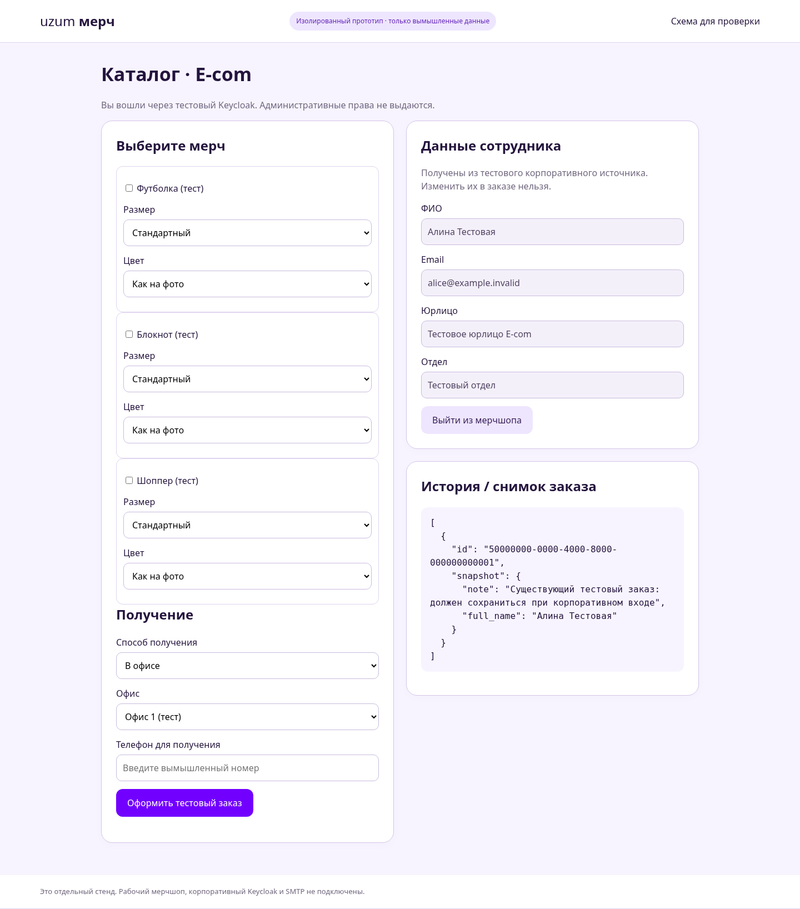
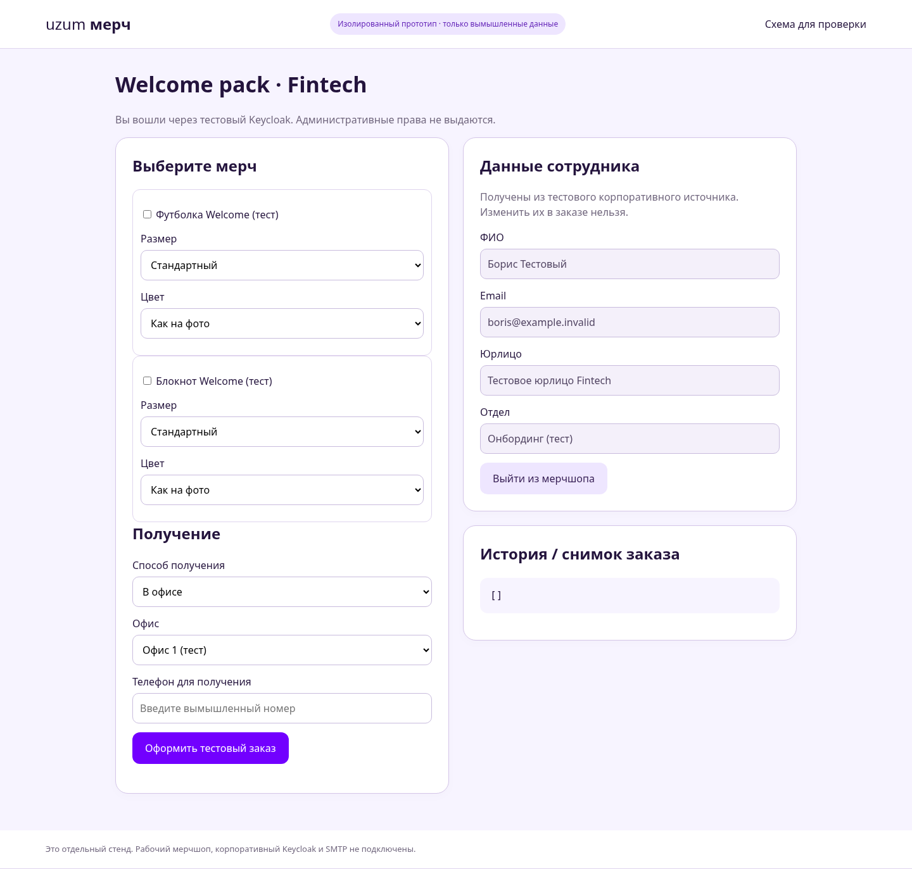
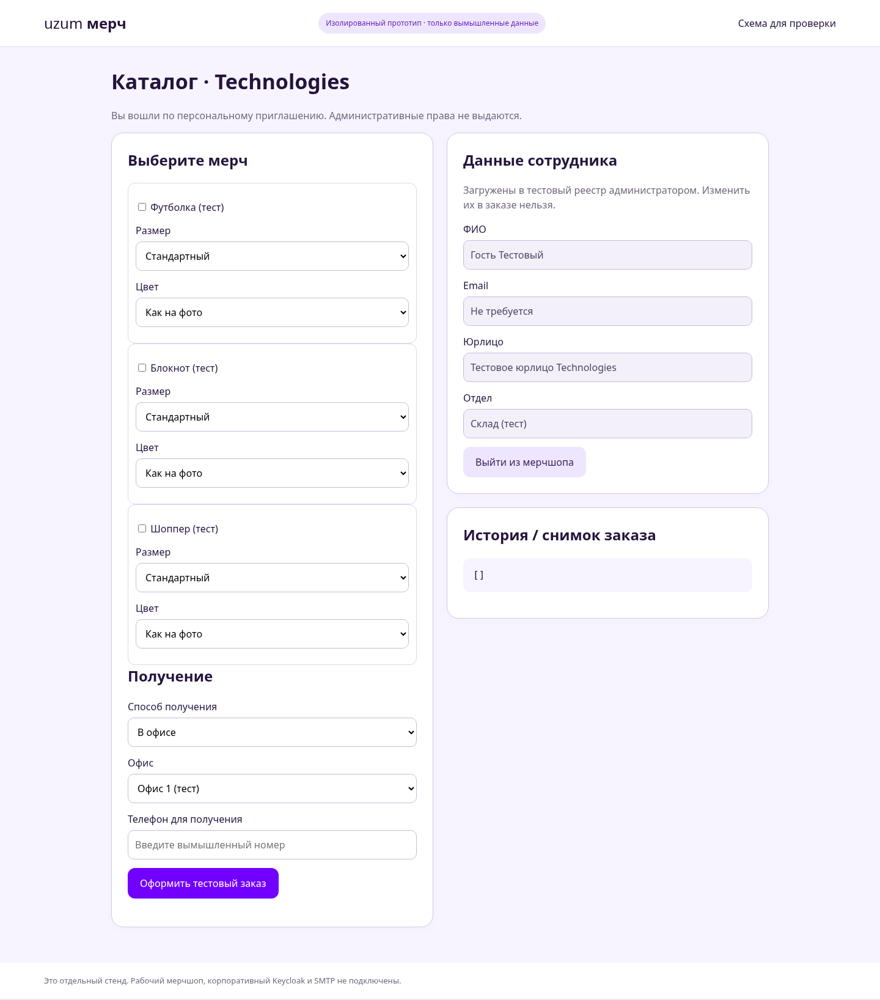
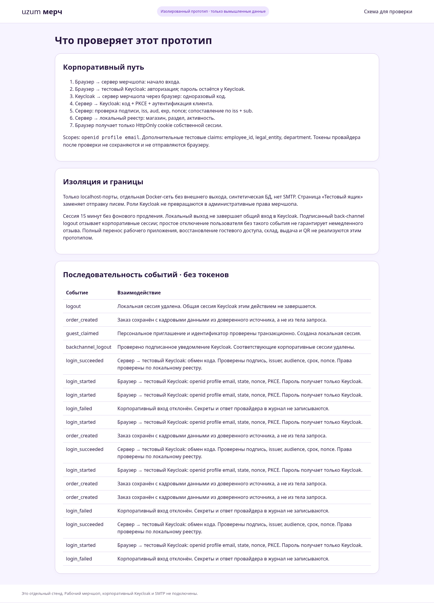

# Что показать на предварительной проверке

Это автономная демонстрация на вымышленных данных, без корпоративных подключений. В рабочий мерчшоп ничего из этого стенда не установлено.

## 1. Корпоративный сотрудник

Тестовый Keycloak подтверждает личность. Мерчшоп проверяет разрешение реестра, открывает E-com и показывает ФИО, email, юрлицо и отдел без редактирования. Уже существующий заказ сохраняется. Телефон и получение заполняются при заказе.

## 2. Welcome pack

Другой вымышленный сотрудник получает только Welcome pack Fintech. Основной каталог и отправка ему недоступны. Это разрешение мерчшопа, не автоматическое назначение по роли Keycloak.

## 3. Персональное приглашение без корпоративного входа

Человек активирует персональную ссылку своим тестовым идентификатором. Email и пароль не нужны. Кадровые данные берутся из реестра, а не из Keycloak. Повторное посещение работает через сохранённую браузерную сессию. ПВЗ доступен этому типу входа.

## 4. Схема обмена и журнал

Страница объясняет, кто к кому обращается, какие данные передаются, и показывает события без паролей и токенов. Подробная спецификация: [ARCHITECTURE.md](ARCHITECTURE.md).

## Для живой демонстрации

Запустить стенд по [README.md](README.md). Последовательно показать alice, boris, outsider, blocked и персональное приглашение. Для смены корпоративного пользователя использовать отдельное окно инкогнито/профиль браузера: локальный выход мерчшопа намеренно не завершает общую SSO-сессию Keycloak.

Код не следует подключать к реальному провайдеру заменой URL. Переход к рабочей интеграции описан отдельно в [MIGRATION.md](MIGRATION.md).
