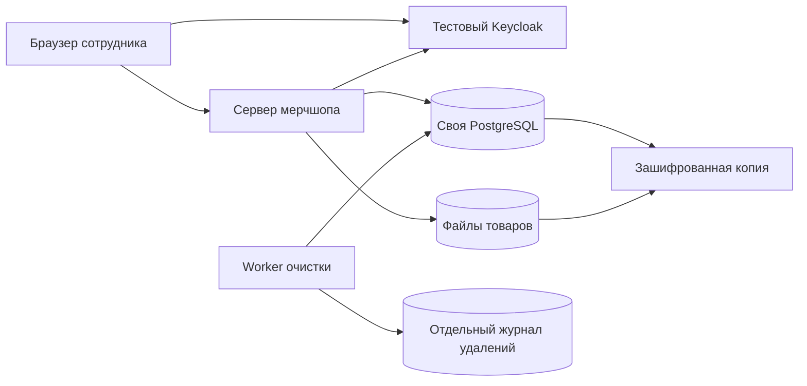

# Где, какие данные и как долго хранятся

**Сейчас это только стенд на вымышленных данных в облачной среде разработки. Корпоративный сервер ещё не выделен.** Никакие реальные данные из действующего Supabase сюда не копируются. При переносе этот же состав компонентов размещается в инфраструктуре компании; это не происходит автоматически от создания данного кода.

## Поток

Браузер работает с сервером приложения и провайдером входа. К PostgreSQL напрямую он не подключается. Keycloak подтверждает личность, а разрешение на магазин, участие и административная роль определяются в БД мерчшопа. Реальный портал не вызывается: используется синтетический OIDC-контракт `openid profile email` с подписанными кодом юрлица, группами мерча и признаком действующего сотрудника. Поиск людей работает по вымышленному адаптеру в коде, без HR API. При допуске по правилу минимальная запись участника создаётся при первом входе; вся база работников не импортируется.

## Места хранения

| Данные | Сейчас в стенде | После внутреннего размещения |
| --- | --- | --- |
| Профили, разрешения, заказы, склад, аудит | БД `merch_selfhost_demo`; volume `merch-selfhost-demo_database`, путь контейнера `/var/lib/postgresql/data` | Отдельная корпоративная PostgreSQL; имя/сервер назначает IT |
| Фотографии товаров | Volume `merch-selfhost-demo_product-files`, `/data/files`; только два сгенерированных изображения | Корпоративный файловый volume или объектное хранилище с ограниченным доступом |
| Учётные записи провайдера | Volume `merch-selfhost-demo_identity-provider`, отдельный тестовый Keycloak | Существующий корпоративный Keycloak; его данные не становятся частью БД мерчшопа |
| Сессии приложения | HMAC токенов в PostgreSQL, исходный случайный токен в HttpOnly cookie браузера | Аналогично, с HTTPS и Secure cookies |
| Приглашения | Хэши токена и идентификатора в БД; техническая привязка к получателю | Внутренняя БД, временная запись |
| Тестовые письма | Зашифрованное содержимое `demo_outbox` в БД; доступ организатора своего магазина | Реальная очередь/SMTP — отдельная доработка и политика удаления; SMTP сейчас не вызывается |
| Код QR | Хэш в БД и временно зашифрованный оригинал; SVG генерируется по запросу | Аналогично после проверки целевой криптографии и хранения ключей |
| Журнал удаления | Volume `merch-selfhost-demo_deletion-ledger`, `/data/ledger/deletions.json` | Отдельное защищённое долговременное хранилище метаданных удаления, не откатываемое при restore |
| Зашифрованные копии | Игнорируемая папка `.local/backups` машины, где запускается команда backup | Отдельное корпоративное backup-хранилище с независимыми доступами/жизненным циклом |
| Тестовые секреты | `.local/demo.env`, вне Git; необходимые значения передаются отдельным контейнерам | Корпоративный secret manager; ключи должны храниться отдельно от данных/архивов |

Docker volumes сейчас находятся на диске Docker-хоста этой тестовой среды. Это не внешняя SaaS-БД и не автоматически зашифрованный диск. Готовый стенд **не означает**, что компания уже предоставляет сервер, шифрование томов или production-резервирование.

## Персональные данные приложения

В профиле участника: ФИО, email для корпоративного входа или личная почта приглашённого новичка Welcome pack, случайный ID записи, `issuer + subject` для корпоративной привязки, магазин/раздел/участие и активность. Для гостя email не нужен, кадровый код открытым текстом в реестре не сохраняется: проверяется HMAC с индивидуальным ID приглашения. Это по-прежнему персональные/связанные технические данные, не обезличивание.

Нет телефона, адреса, города/страны, ПВЗ, отдела, должности, даты найма и свободного комментария. **Код юрлица, список групп мерча и признак активности** временно хранятся в `demo_sessions.portal_claims` для перепроверки правил доступа; удаляются вместе с 15-минутной сессией. В профиле/заказе они не дублируются. В `demo_portal_rules` хранятся выбранные коды юрлиц/групп либо subject отдельного человека, раздача/раздел и решение; subject — связанный с человеком технический идентификатор. Эти правила удаляются при очистке раздачи. Синтетический каталог `portal-directory.mjs` — только вымышленные примеры, настоящие люди в коде недопустимы. Реестр здесь — список участников конкретной раздачи, не выгрузка кадрового справочника. Учётные записи организаторов отделены от участия в раздаче и имеют собственную цель и жизненный цикл.

В заказе: ссылка на аккаунт, раздача и магазин, товары/размеры/количество, статусы и даты. ФИО/email не дублируются в снимке заказа. QR содержит случайную строку без имени/телефона. После выдачи или отмены зашифрованный оригинал кода стирается; хэш остаётся до очистки заказа для защиты от повторной выдачи.

Аудит содержит вид операции, время и, для ключевых складских операций, ID исполнителя. Он может быть связан с человеком и требует защиты как персональные данные, даже если текст не содержит ФИО. В текст не записываются тела запросов, контакты, пароли, токены или ссылки.

## Сроки, демонстрируемые кодом

| Категория | Поведение стенда |
| --- | --- |
| Профили участников и связанные заказы | Очистка через **30 дней после закрытия раздачи**, не сразу после индивидуальной выдачи |
| Приглашения | Начальное — 7 дней; новое/восстановительное — 1 день. Истёкшие и отозванные удаляются worker |
| Письма тестового ящика | Не дольше срока записи (1/7 дней) либо до удаления участника |
| Сессии | 15 минут без автоматического продления; истёкшие удаляются worker, logout удаляет сразу |
| OIDC flows | 5 минут; использованный flow потребляется однократно, истёкшие удаляются worker |
| Прикладной аудит | Удаляется по истечении 30 дней |
| Локальные зашифрованные копии | Удаляются старше 7 дней при следующем запуске команды backup; расписание не настроено |

**30/7/1 день — демонстрационные параметры, а не утверждённые требования DPO.** В БД policy задаёт профильный и журнальный сроки; прежде чем применять к настоящим сотрудникам, сроки должны быть согласованы. Нельзя просто сократить их до нуля: до окончания раздачи нужны контроль права заказа, резерв и защита повторной выдачи.

Worker работает каждые 5 секунд. Сначала фиксирует намерение удаления в независимом журнале, затем транзакционно удаляет личные записи. Закрытие раздачи прекращает вход участников, отменяет незавершённые заказы и освобождает их резерв. В служебные аккаунты организаторов очистка участников не вмешивается.

Удаляются правила доступа раздачи, профиль, аккаунт участника, его сессии, приглашения, письма, заказы/позиции и индивидуальные складские движения этой раздачи. Сохраняются текущие остатки, товарный справочник и суммарные количества выданного по варианту без ID получателя. Небольшие группы могут оставаться косвенно узнаваемыми; признание агрегатов анонимными и допустимая детализация требуют оценки DPO.

## Что не исчезает от очистки этой БД

- Копии в backup: там данные сохраняются до уничтожения соответствующей копии. Restore обязан повторно применить независимый журнал удалений **до открытия приложения**.
- Источник Keycloak: удаление участника раздачи не удаляет корпоративную учётную запись. Источник авторизации и его журналы имеют отдельную цель/владельца/политику.
- Cookie/скачанный SVG/CSV и распечатки на устройстве. Сервер отзывает доступ, но не может удалить чужой скачанный файл или бумагу.
- Docker/OS/прокси-журналы: отдельные инфраструктурные места хранения. Очистка `demo_events` не управляет ими.
- Тестовые seed-файлы в коде и `.local/realm.json`: они содержат только явно вымышленные образцы. Настоящие кадровые данные нельзя зашивать в seed/исходники.

## Восстановление

Поддерживаемый restore принимает только аутентифицированный архив той же установки и требует отдельный журнал удалений. При отсутствии/повреждении/несоответствии журнала сервис не должен открываться. После восстановления отзываются старые сессии и приглашения, раздачи закрываются, ранее удалённые участники повторно очищаются до старта приложения.

Состояние физической выдачи после времени резервной копии невозможно восстановить из старой копии само по себе. Поэтому этот скрипт намеренно не возобновляет раздачи: нужна сверка остатков/операций организатором. Production PITR, резервирование и процедуры аварийного восстановления должны быть настроены IT отдельно.

## Новички с личной почтой

В `demo_employees` дополнительно: признак email-приглашения на Welcome pack, время первого подтверждения почты, срок доступа и факт/дата получения (`email_welcome`, `email_verified_at`, `access_expires_at`, `welcome_received_at`). Это персональные данные и признаки доступа. В `demo_email_links` — хэш случайной ссылки, связь с участником, срок 20 минут, дата использования; исходный токен только в зашифрованном тестовом письме и фрагменте ссылки. Браузер сразу убирает фрагмент из адресной строки, подтверждение выполняется отдельным POST с CSRF-проверкой. Никаких личных паролей Merch Shop не создаёт и не хранит.

Повторный вход использует тот же аккаунт. Выдача закрывает его доступ и удаляет сессии, ссылки и письма одной транзакцией с заказом/складом. Это закрытие доступа, **не немедленное удаление профиля и истории**. Они удаляются штатно через демонстрационные 30 дней после закрытия раздачи. Просроченные email-ссылки удаляет worker; счётчики антиспама (`demo_email_throttles`) содержат HMAC сетевого адреса, счётчик и минутный срок, затем очищаются worker. Исходный IP специально не записывается этой функцией; инфраструктурные журналы имеют отдельную политику.

Email-ссылки и счётчики также очищаются при поддерживаемом restore до открытия приложения. Тестовые письма не старше 20 минут, для завершённого/отозванного доступа новые письма не выдаются. Реального SMTP нет. Сроки, цель использования личной почты и долгосрочный учёт факта Welcome pack должны быть согласованы до обработки настоящих сотрудников. Без постоянного учётного источника нельзя гарантировать «один Welcome pack за всю жизнь» после удаления профиля либо при нескольких адресах одного человека.
