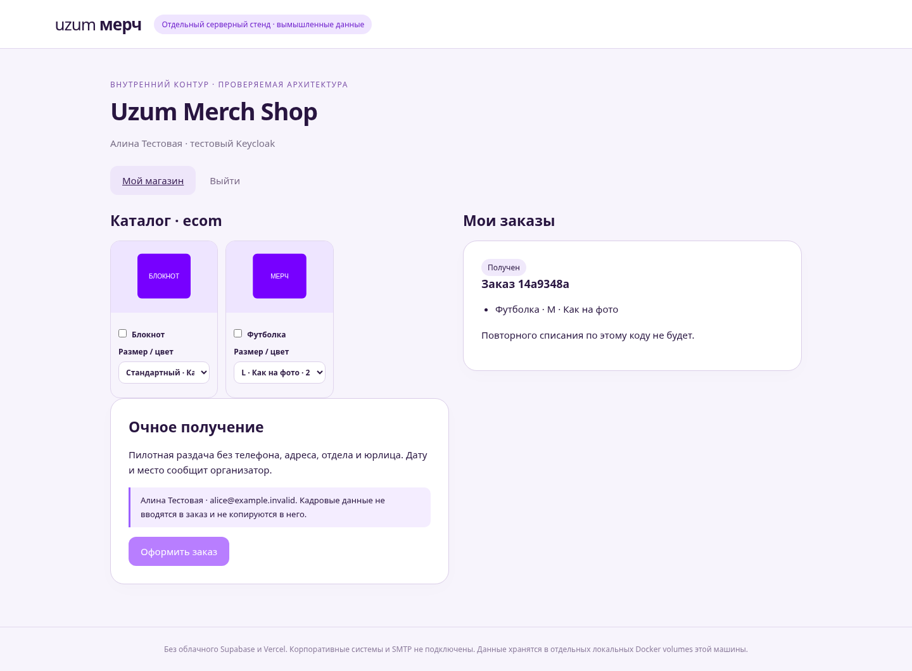
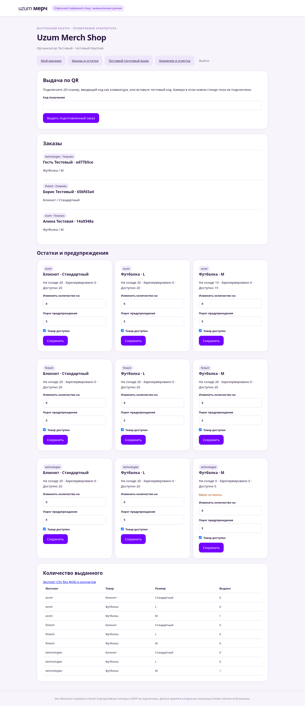
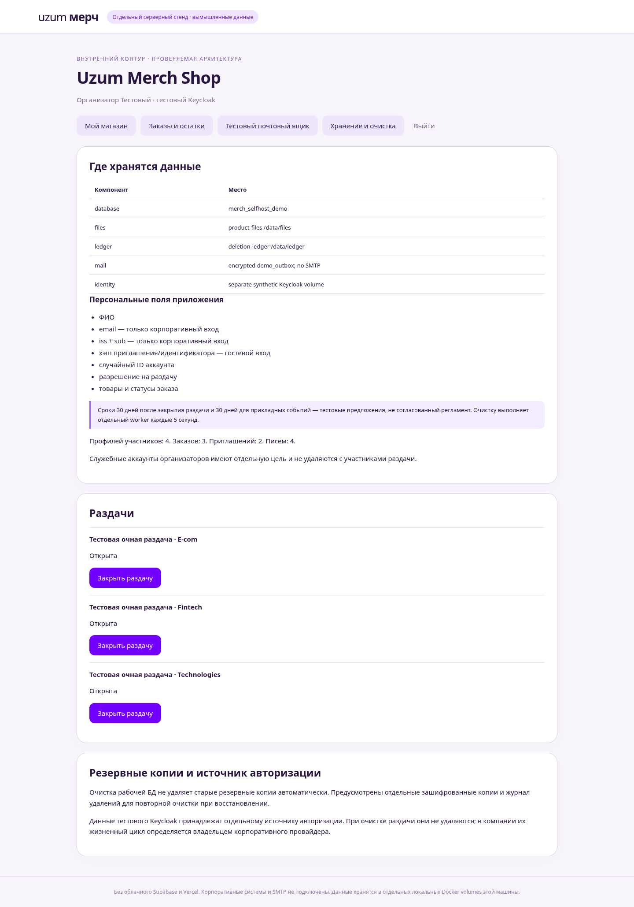
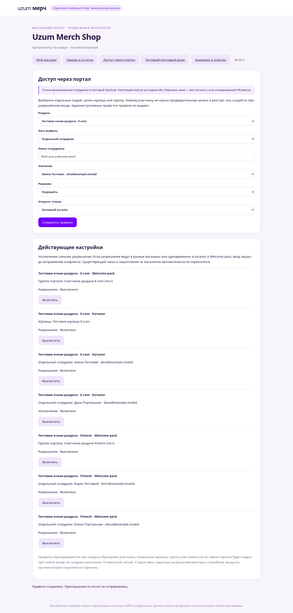

# Демонстрация нового контура

Все имена, email, товары и заказы вымышлены. Это отдельный прототип, не действующая система компании.

## Получатель

Вход через тестовый Keycloak или персональную ссылку. Заказ не просит телефон и адрес: пилот только очный. Товары резервируются в своей PostgreSQL, готовность проверяется при выдаче.

## Организатор

Локальная роль определяет доступные магазины. Подготовка заказа и выдача по QR, остатки по размерам, предупреждения и количественная CSV-выгрузка.

## Хранение и очистка

Показаны места хранения, минимальные поля, демонстрационные сроки, счётчики и закрытие раздач. Реальная очистка выполняется worker, а не кнопкой, которая просто скрывает строки.

Проверенный сценарий: закрыли E-com, смоделировали прошедший срок хранения, дождались удаления связанных персональных записей, восстановили старый архив. Независимый журнал повторно очистил ранее удалённого участника до открытия приложения. Остальные раздачи при восстановлении закрываются для сверки физической выдачи.

Инструкция запуска: [README.md](README.md). Подробное описание для IT/DPO: [DATA-STORAGE.md](DATA-STORAGE.md). Требования перед реальными данными: [OPERATIONS.md](OPERATIONS.md).

## Допуск по данным портала

Организатор выбирает отдельных людей из тестового каталога, юрлицо или группу. Новому человеку не нужна предварительная запись в HR-реестре: минимальный участник создаётся при разрешённом входе. Можно отдельно открыть каталог либо Welcome pack, добавить исключение или выключить правило.

Это моковый справочник и отдельный тестовый Keycloak. Настоящий поиск сотрудников потребует согласованного API корпоративного портала. Сценарий Welcome-pack по личной почте реализован в этом серверном стенде через одноразовые ссылки и зашифрованный тестовый почтовый ящик. Настоящего SMTP нет; после получения доступ закрывается. Подробности — в README.md.
